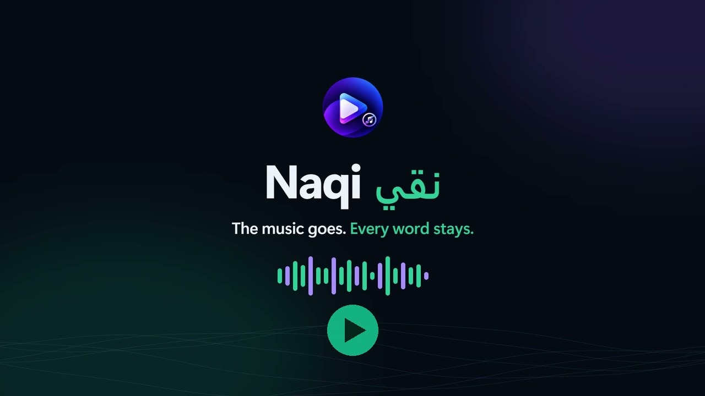

<p align="center">
  
</p>

<h1 align="center">Naqi | نقي</h1>

<p align="center">
  <strong>Remove the music from any video, keep every voice.</strong><br>
  A Windows desktop app that strips background music from online videos and your own files, entirely on your PC.
</p>

<p align="center">
  
  
  
  
</p>

---

## Demo

<p align="center">
  <a href="media/naqi-demo.mp4"></a><br>
  <a href="media/naqi-demo.mp4"><b>▶ Watch the 3-minute demo</b></a> (1080p, with sound): every feature, recorded in the real app.
</p>

## Overview

Naqi takes a video link or a file from your computer and plays it back without the music. Talking, singing and
everyday sounds (footsteps, applause, nature) stay; instruments are removed. The picture stays in sync, because the
music is removed from the sound track instead of cutting the video.

Watch first, save later: a video starts playing while it is still being cleaned, and you save it as MP3 or MP4 only
if you want to keep it. All processing runs locally on your graphics card. Nothing is uploaded, and there are no
accounts or tracking.

## Features

- **Clean and play.** Paste one link or drop one file and it plays in the window about 20 seconds later, cleaned in
  growing pieces ahead of the playhead. You can jump anywhere in the part that is already clean.
- **Any video link.** YouTube (videos and playlists), TikTok, Facebook, Instagram, X and the other sites supported by
  [yt-dlp](https://github.com/yt-dlp/yt-dlp). No login is ever needed. yt-dlp keeps itself up to date.
- **Your own files.** Drag and drop audio or video files, several at once. The originals are never changed. Videos
  the window cannot show directly get a quick playable copy.
- **Save as MP3 or MP4.** From the player, at the original size or 1080p, 720p or 480p; MP3 at 128, 192 or 320 kbps.
  Several files or a playlist are cleaned and saved in one go, in one folder per day.
- **Library.** Every cleaned file is listed on the left, to play again, rate *Bad*, *Good* or *Perfect*, or show in
  its folder. Kept sounds are tidied away after two weeks or 5 GB.
- **Report a slip.** Mark a moment where music was heard or a voice was cut, right from the player. It is saved as a
  permanent test case so future versions can be checked against it.
- **Light and dark.** Follows the Windows theme, with a button to choose.

## How it works

```
 video link ──► yt-dlp ──┐
                         ├──► Mel-Band Roformer ──► Bandit v2 ──► music-trace ──► player / ffmpeg
 your file ──────────────┘    keeps the voices      keeps the     mutes moments    plays it, or writes
                                                    other sounds  where music      MP3 / MP4
                                                                  still shows
```

1. **Download.** yt-dlp fetches the sound (the picture is streamed while you watch), or Naqi opens your own file.
2. **Voices.** [Mel-Band Roformer](https://huggingface.co/KimberleyJSN/melbandroformer) separates all voices,
   including singing, from the rest.
3. **Other sounds.** [Bandit v2](https://zenodo.org/records/12701995) recovers sound effects from what is left and
   drops the music.
4. **Safety check.** The music-trace check compares what was kept with what was removed and mutes short moments
   where music would still be heard. When unsure, it mutes.
5. **Play or save.** The cleaned sound plays with the picture in sync, and ffmpeg writes an MP3 or MP4 when you save.

The window is HTML, CSS and JavaScript; the cleaning engine is Python, running next to it as a small local server
that only this PC can reach.

## Performance

Measured on an NVIDIA RTX 4050 Laptop GPU (6 GB VRAM).

| Video length | Time to clean | Speed | Peak VRAM |
|---|---|---|---|
| 5 min | ~45 s | ~7x realtime | 3.2 GB |
| 41 min | ~5.2 min | ~7.9x realtime | 3.3 GB |

Playback starts about 18 seconds after the click. VRAM use does not grow with the length of the video. Without an
NVIDIA graphics card Naqi runs on the CPU at about 0.3x realtime, and plays once the whole file is clean.

### Accuracy

Scored on 140 test mixes of speech, singing and sound effects over music:

| Measure | Result |
|---|---|
| Time where music is heard on its own | 2% |
| Time where music is clearly audible | 6% |
| Talking lost | 7% |
| Singing lost | 7% |
| Sound effects lost | 25% |

## Requirements

- Windows 10 or 11 (64-bit)
- An NVIDIA graphics card with at least 6 GB of VRAM is recommended; other PCs work on the CPU, much more slowly
- About 7 GB of free disk space for the installed app

## Getting started

### Install

Run `Naqi-Setup.exe`. It installs for your Windows user only (no administrator rights), with everything inside:
the models, ffmpeg and the downloader. Nothing else needs to be set up.

### Run from source

Needs Node.js 24, Python 3.12 (`py -3.12`), and ffmpeg and Deno on the `PATH`.

```bat
git clone https://github.com/yassinemaazaoui114-git/Naqi.git
cd Naqi
npm install
py -3.12 -m pip install torch torchaudio --index-url https://download.pytorch.org/whl/cu126
py -3.12 -m pip install numpy einops rotary-embedding-torch beartype "yt-dlp[default,curl-cffi]"
npm start
```

The two model files are too large for GitHub. Download them into `%USERPROFILE%\Naqi-data\models`:

| File | Source | License |
|---|---|---|
| `MelBandRoformer.ckpt` | [KimberleyJSN/melbandroformer](https://huggingface.co/KimberleyJSN/melbandroformer) | see source |
| `bandit_v2_multi.ckpt` | [Bandit v2 on Zenodo](https://zenodo.org/records/12701995) | CC BY-SA 4.0 |

### Build the installer

```bat
npm run installer
```

Builds the window, packs the engine with PyInstaller (models, ffmpeg and Deno included) and makes a per-user installer
with Inno Setup. The result, `Naqi-Setup.exe`, is written to `%USERPROFILE%\Naqi6-build\installer`.

### Tests

Each part has its own self-test (`src/main/*test.js`, `engine/test_*.py`). Quick engine measurement:

```bat
py -3.12 bench\test_speech_only.py path\to\clip.mp3
```

Accuracy benchmarks: `py -3.12 -I bench\benchmark.py -h` and `py -3.12 -I bench\r7_bench.py -h`.

## Project structure

| Path | Contents |
|---|---|
| `src/main/` | The app's main process: window, engine start-up, self-tests |
| `src/preload/` | The safe bridge between the page and the main process |
| `src/renderer/` | The pages (Home, library, player, Report a slip) and the design system |
| `engine/` | The cleaning engine: music removal, downloads, history, player media, saving, local server |
| `engine/separators/` | Model code for Mel-Band Roformer and Bandit v2 |
| `bench/` | Accuracy benchmarks and separator comparisons |
| `build/` | Icons and the installer recipe |

## Known limitations

- Faint music can still be heard at moments, and some sound effects are muted together with the music.
- Without an NVIDIA graphics card, cleaning is too slow for long videos.
- Private or login-only videos cannot be downloaded; save the file and drop it into Naqi instead.

## Privacy

Naqi does not send audio, video or usage data anywhere. The only network traffic is the video download itself and
the downloader's own updates.

## License

Naqi is released under the [MIT License](LICENSE).

The code in `engine/separators/` comes from
[Music-Source-Separation-Training](https://github.com/ZFTurbo/Music-Source-Separation-Training) and keeps its own MIT
license (`engine/separators/LICENSE`). Model files are not covered by this license and remain under their authors'
terms.

## Acknowledgements

[yt-dlp](https://github.com/yt-dlp/yt-dlp) ·
[ffmpeg](https://ffmpeg.org) ·
[PyTorch](https://pytorch.org) ·
[Music-Source-Separation-Training](https://github.com/ZFTurbo/Music-Source-Separation-Training) ·
[Bandit v2](https://zenodo.org/records/12701995) ·
[Demucs](https://github.com/facebookresearch/demucs) (used in the benchmarks)
